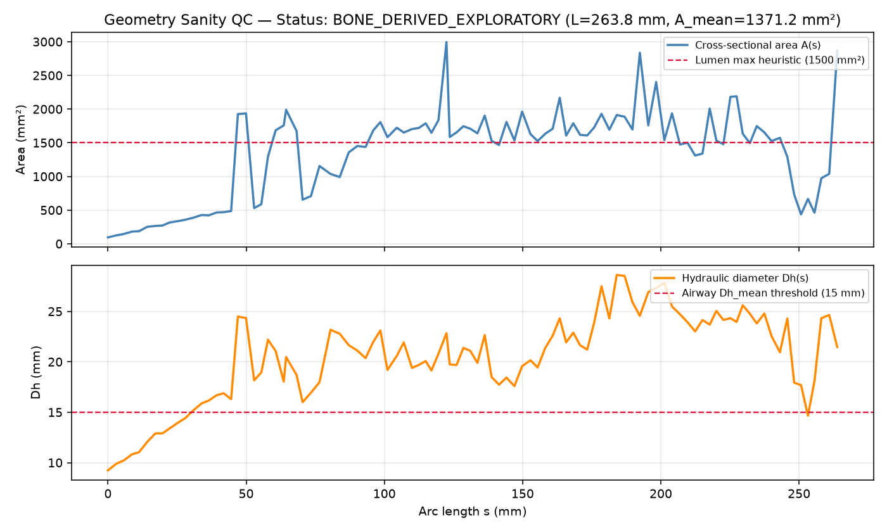
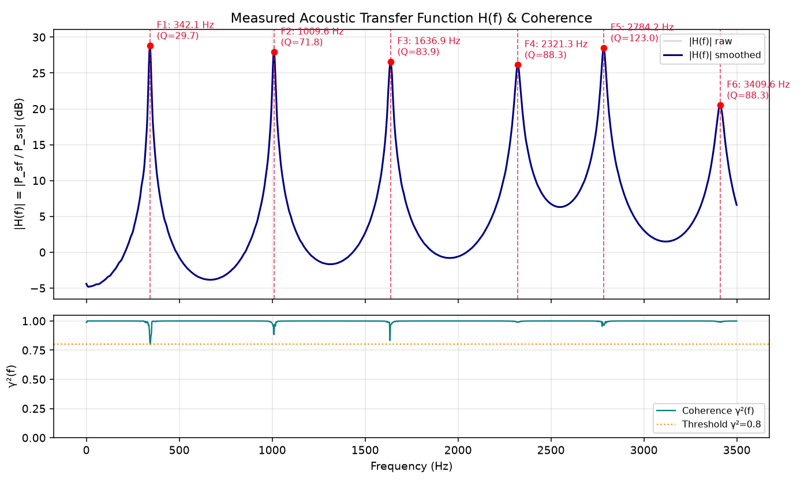
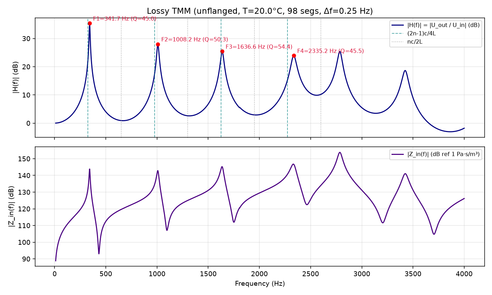
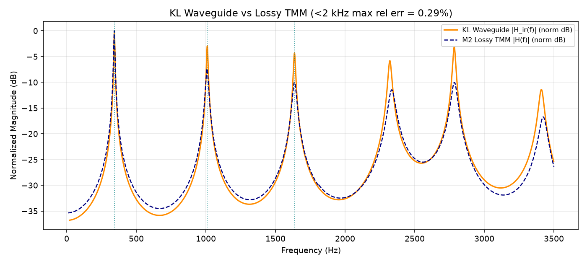

# Paleo-Acoustic Run Report — `parasaurolophus_ram14000_20261117T104254Z_19c2be`

## 1. Summary

| Field | Value |
| :--- | :--- |
| Taxon / Specimen | Parasaurolophus sp. (RAM14000) |
| Synth Mode | `kl` |
| Terminal State | **`EXPLORATORY`** |
| Why | All physics, spectral-shaping, and schema checks passed. |
| Measured f0 (YIN) | 60.76 ± 0.81 Hz (prior: 60.0 Hz) |
| Shaping Gain (F1 band) | 11.66 dB |
| Source Spectral Tilt | -9.54 dB/oct (target: -15 to -9 dB/oct) |

## 2. Geometry QC

> [!WARNING]
> **BONE-DERIVED GEOMETRY — EXPLORATORY ONLY.** This profile comes from the bone mesh skeleton rather than a segmented nasal airway lumen. Cross-sectional areas (`A_mean = 1371.2 mm²`, `A_max = 2996.3 mm²`, `Dh_mean = 20.49 mm`) and single-pass length (`L = 263.8 mm`) do not represent a looped soft-tissue airway. This run cannot be `SCIENTIFICALLY_VALIDATED`.

- **Status:** `BONE_DERIVED_EXPLORATORY`
- **Length:** 263.804 mm | **Mean Area:** 1371.20 mm² | **Max Area:** 2996.32 mm² | **Mean Dh:** 20.49 mm | **Sections:** 99
- **Source Mesh:** `paleo_acoustic_data/RightSkeleton_RAM14000_printable2.stl` (`bone_mesh_skeleton_axis_slice`)
- **Flags:** ['suspiciously wide for a nasal airway (Dh_mean=20.49 mm > 15.0 mm)', 'area values compatible with bone/crest cross-sections, not lumen (A_max=2996.3 mm^2 > 1500.0 mm^2)', 'profile derived from bone mesh', 'looped airway length unverified']



## 3. Formants: Measured vs Predicted (Lossy TMM) vs Analytic

| Mode | Measured H(f) (Hz) | Measured LPC (Hz) | Predicted Lossy TMM (Hz) | Analytic c/4L (Hz) | Analytic c/4L_eff (Hz) |
| :--- | :--- | :--- | :--- | :--- | :--- |
| F1 | 342.06 (Q=29.7, γ²=0.824) | 212.50 | 341.69 (Q=45.0) | 325.05 | 303.71 |
| F2 | 1009.56 (Q=71.8, γ²=0.960) | 1623.06 | 1008.24 (Q=50.3) | 975.16 | 911.13 |
| F3 | 1636.94 (Q=83.9, γ²=0.964) | 2547.14 | 1636.56 (Q=54.4) | 1625.26 | 1518.54 |

- **LPC Reliability:** `low` (['low_f0_dense_harmonics_le_75hz'])
- **Why TMM F1 differs from c/4L:** Unflanged Levine–Schwinger end correction lengthens the effective tube from $L = 0.2638\text{ m}$ to $L_{\text{eff}} = 0.2823\text{ m}$ (lowering uniform $c/4L_{\text{eff}}$ to `303.71` Hz), whereas strong cross-sectional flaring from `1371` mm² average (up to `2996` mm²) acts like an expanding horn that pushes the fundamental resonance upward to `341.69` Hz.

## 4. Measured Transfer Function H(f)



## 5. Lossy Kirchhoff TMM Spectrum



## 6. Kelly–Lochbaum Waveguide vs Lossy TMM

| Formant | TMM (Hz) | KL Impulse (Hz) | Rel Error | TMM Q | KL Q |
| :--- | :--- | :--- | :--- | :--- | :--- |
| — | 341.69 | 342.67 | 0.285% | 45.0 | 45.7 |
| — | 1008.24 | 1009.87 | 0.162% | 50.3 | 80.8 |
| — | 1636.56 | 1636.33 | 0.014% | 54.4 | 109.1 |



## 7. Band Energy Fractions (Filtered vs Source)

| Band (Hz) | Filtered Fraction | Source Fraction |
| :--- | :--- | :--- |
| 0-100 | 28.574% | 69.095% |
| 100-300 | 19.538% | 26.698% |
| 300-420 | 30.009% | 2.041% |
| 420-800 | 1.190% | 1.084% |
| 800-1500 | 3.478% | 0.403% |
| 1500-3000 | 13.921% | 0.395% |
| 3000-22050 | 3.291% | 0.284% |

## 8. Source Spectral Tilt

- Measured harmonic tilt (100–2000 Hz): **-9.54 dB/octave**

## 9. Assumptions

```json
{
  "air": {
    "T_c": 20.0,
    "c": 343.0,
    "rho": 1.204,
    "mu": 1.81e-05,
    "gamma": 1.4,
    "Pr": 0.71
  },
  "soft_tissue": {
    "lining_present": true,
    "lining_thickness_mm": 2.0,
    "glottal_source": "two_mass_stochastic",
    "boundary_condition": "open_nostril_approx_Z0",
    "temperature_c": 20.0,
    "speed_of_sound_m_s": 343.0,
    "confidence": 0.55,
    "notes": "Soft tissues not preserved; lining thickness and glottal parameters are explicit priors.",
    "f0_prior_hz": 60.0,
    "source_model": "interactive_two_mass_glottal_flow_derivative_with_aspiration",
    "tract_model": "kelly_lochbaum_radiated_pressure"
  },
  "radiation_model": "unflanged"
}
```

## 10. Warnings

- Optional dependency 'soundfile' is not installed.
- Optional dependency 'trimesh' is not installed.
- ka > 1 inside band of interest (max ka=2.21); switched to Silva et al. (2009) rational fit above ka=1.

## 11. Limits

- **Bone-derived geometry:** Unless a validated CT lumen or endocast profile with `.source.json` is supplied, the cross-sectional profile reflects bone wall geometry rather than the true looped nasal passage.
- **Unknown larynx / syrinx:** No fossilized laryngeal soft tissues are preserved; the two-mass vocal-fold model and subglottal pressure are biomechanical hypotheses.
- **Soft tissue absent:** Mucosal lining, wall compliance, and nasal valve geometry are not directly observable in the fossil STL.
- **f0 prior:** `f0_prior_hz = 60.0 Hz` is a soft-tissue assumption, not an anatomical measurement.

## 12. Artifacts

- `source.wav`: `C:\Users\balad\OneDrive\Documents\Paléo-acoustique\paleoacoustique\output\parasaurolophus_ram14000_20261117T104254Z_19c2be\source.wav`
- `filtered.wav`: `C:\Users\balad\OneDrive\Documents\Paléo-acoustique\paleoacoustique\output\parasaurolophus_ram14000_20261117T104254Z_19c2be\filtered.wav`
- `spectrogram.png`: `C:\Users\balad\OneDrive\Documents\Paléo-acoustique\paleoacoustique\output\parasaurolophus_ram14000_20261117T104254Z_19c2be\spectrogram.png`
- `transfer_function.png`: `C:\Users\balad\OneDrive\Documents\Paléo-acoustique\paleoacoustique\output\parasaurolophus_ram14000_20261117T104254Z_19c2be\transfer_function.png`
- `tmm_lossy.png`: `C:\Users\balad\OneDrive\Documents\Paléo-acoustique\paleoacoustique\output\parasaurolophus_ram14000_20261117T104254Z_19c2be\tmm_lossy.png`
- `kl_vs_tmm.png`: `C:\Users\balad\OneDrive\Documents\Paléo-acoustique\paleoacoustique\output\parasaurolophus_ram14000_20261117T104254Z_19c2be\kl_vs_tmm.png`
- `geometry_qc.png`: `C:\Users\balad\OneDrive\Documents\Paléo-acoustique\paleoacoustique\output\parasaurolophus_ram14000_20261117T104254Z_19c2be\geometry_qc.png`
- `measured.json`: `C:\Users\balad\OneDrive\Documents\Paléo-acoustique\paleoacoustique\output\parasaurolophus_ram14000_20261117T104254Z_19c2be\measured.json`
- `tmm_lossy.json`: `C:\Users\balad\OneDrive\Documents\Paléo-acoustique\paleoacoustique\output\parasaurolophus_ram14000_20261117T104254Z_19c2be\tmm_lossy.json`
- `report.md`: `C:\Users\balad\OneDrive\Documents\Paléo-acoustique\paleoacoustique\output\parasaurolophus_ram14000_20261117T104254Z_19c2be\report.md`
- `build_log.txt`: `C:\Users\balad\OneDrive\Documents\Paléo-acoustique\paleoacoustique\output\parasaurolophus_ram14000_20261117T104254Z_19c2be\build_log.txt`
