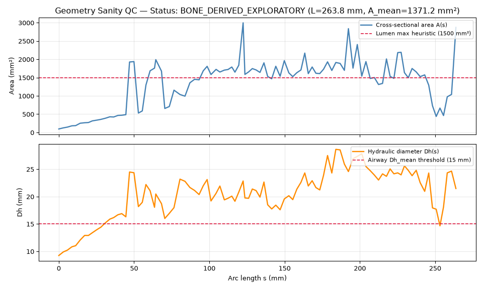
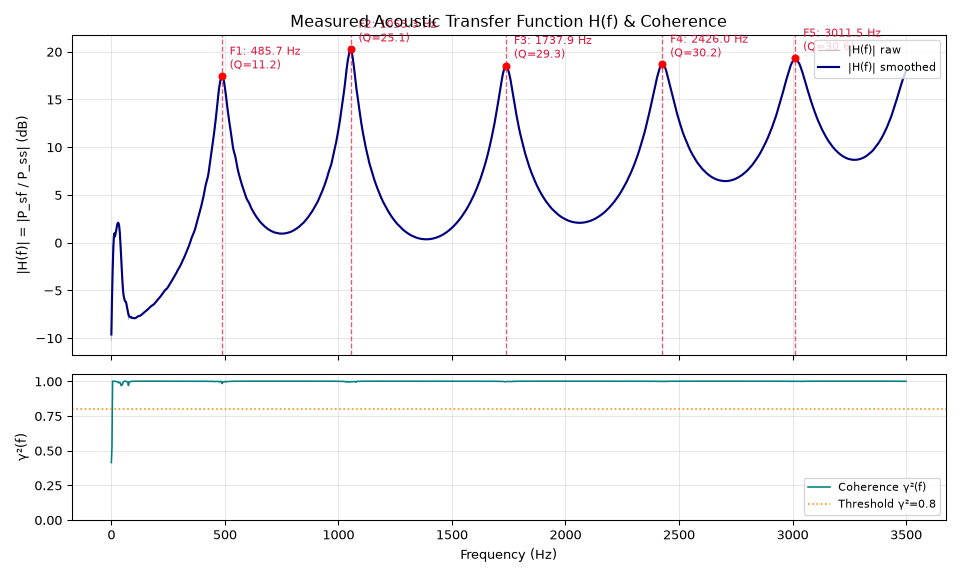
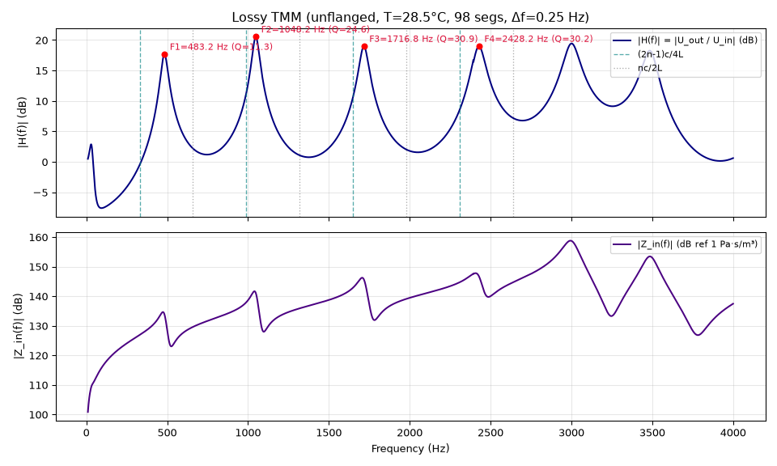
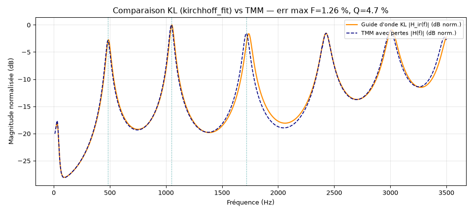
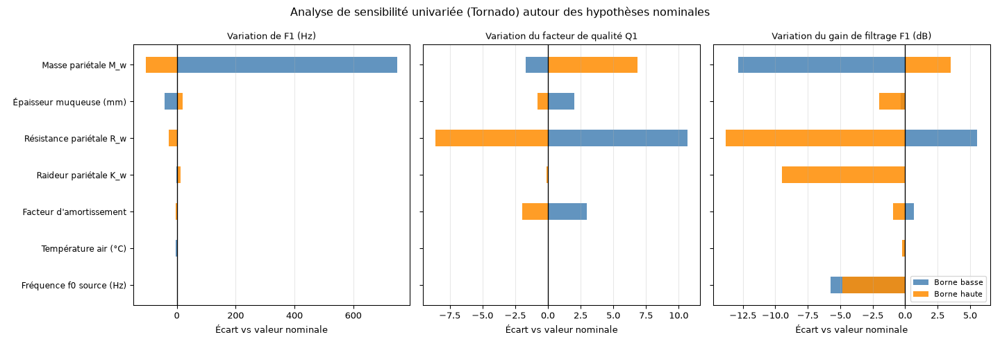
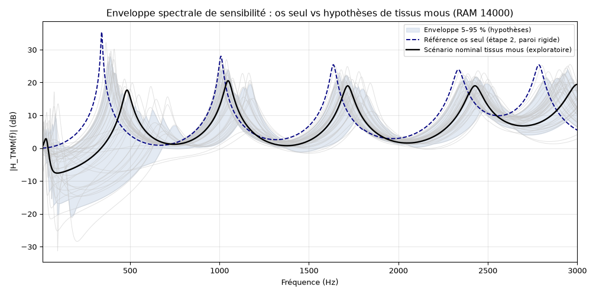
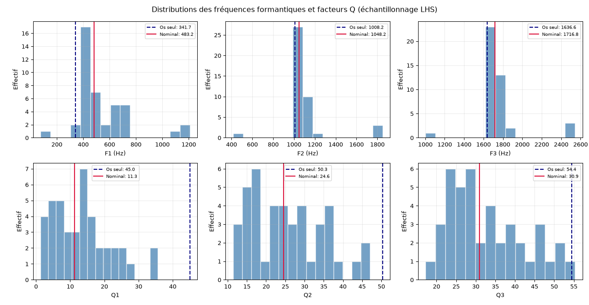

# Paleo-Acoustic Run Report — `parasaurolophus_ram14000_20261117T223414Z_2b13b0`

## 1. Summary

| Field | Value |
| :--- | :--- |
| Taxon / Specimen | Parasaurolophus sp. (RAM14000) |
| Synth Mode | `kl` (KL loss: `kirchhoff_fit`) |
| Provenance | `2f0e96b` (`2f0e96b`) |
| Terminal State | **`EXPLORATORY`** |
| Why | All physics, spectral-shaping, and schema checks passed. |
| Measured f0 (YIN) | 60.08 ± 0.50 Hz (prior: 60.0 Hz) |
| Shaping Gain (`F1 ± B1/2`) | 20.11 dB (legacy `±60 Hz`: 18.14 dB; floor `±60 Hz`: 24.10%) |
| Source Spectral Tilt | -12.05 dB/oct (target: -15 to -9 dB/oct) |

## 2. Geometry QC

> [!WARNING]
> **BONE-DERIVED GEOMETRY — EXPLORATORY ONLY.** This profile comes from the bone mesh skeleton rather than a segmented nasal airway lumen. Cross-sectional areas (`A_mean = 1371.2 mm²`, `A_max = 2996.3 mm²`, `Dh_mean = 20.49 mm`) and single-pass length (`L = 263.8 mm`) do not represent a looped soft-tissue airway. This run cannot be `SCIENTIFICALLY_VALIDATED`.

- **Status:** `BONE_DERIVED_EXPLORATORY`
- **Length:** 263.804 mm | **Mean Area:** 1371.20 mm² | **Max Area:** 2996.32 mm² | **Mean Dh:** 20.49 mm | **Sections:** 99
- **Source Mesh:** `paleo_acoustic_data/RightSkeleton_RAM14000_printable2.stl` (`bone_mesh_skeleton_axis_slice`)
- **Flags:** ['suspiciously wide for a nasal airway (Dh_mean=20.49 mm > 15.0 mm)', 'area values compatible with bone/crest cross-sections, not lumen (A_max=2996.3 mm^2 > 1500.0 mm^2)', 'profile derived from bone mesh', 'end_section_artifact', 'looped airway length unverified']



*Figure 1 — Profil géométrique issu du maillage osseux (section transversale $A(s)$ et diamètre hydraulique $D_h(s)$) : les valeurs dépassent les seuils d'un lumen nasal et classent ce profil en mode exploratoire.*

### End-Section Artifact QC (With vs Without Trim)

- **Flagged end indices:** [98] | **Trim mode:** `0` | **Trimmed:** `False`
- **Length change:** 263.804 mm -> 263.804 mm

| Mode | Untrimmed F (Hz) | Untrimmed Q | Trimmed F (Hz) | Trimmed Q |
| :--- | :--- | :--- | :--- | :--- |
| F1 | 346.75 | 44.2 | 340.77 | 45.4 |
| F2 | 1023.27 | 49.7 | 1014.30 | 52.6 |
| F3 | 1660.98 | 53.8 | 1652.87 | 59.1 |

## 3. Formants: Measured vs Predicted (Lossy TMM) vs Analytic

| Mode | Measured H(f) (Hz) | Measured LPC (Hz) | Predicted Lossy TMM (Hz) | Analytic c/4L (Hz) | Analytic c/4L_eff (Hz) |
| :--- | :--- | :--- | :--- | :--- | :--- |
| F1 | 485.68 (Q=11.2, γ²=0.997) | 589.47 | 483.24 (Q=11.3) | 329.94 | 313.09 |
| F2 | 1053.26 (Q=25.1, γ²=0.995) | 2479.84 | 1048.22 (Q=24.6) | 989.81 | 939.27 |
| F3 | 1737.91 (Q=29.3, γ²=0.997) | 2835.98 | 1716.76 (Q=30.9) | 1649.68 | 1565.45 |

- **LPC Reliability:** `low` (['low_f0_dense_harmonics_le_75hz'])
- **Why TMM F1 differs from c/4L:** Unflanged Levine–Schwinger end correction lengthens the effective tube from $L = 0.2638\text{ m}$ to $L_{\text{eff}} = 0.2780\text{ m}$ (lowering uniform $c/4L_{\text{eff}}$ to `313.09` Hz), whereas strong cross-sectional flaring from `1371` mm² average (up to `2996` mm²) acts like an expanding horn that pushes the fundamental resonance upward to `483.24` Hz.

## 4. Measured Transfer Function H(f)



*Figure 2 — Fonction de transfert acoustique mesurée $H(f) = P_{sf}/P_{ss}$ et cohérence $\gamma^2(f)$ calculées uniquement à partir des signaux audio `source.wav` et `filtered.wav`.*

## 5. Lossy Kirchhoff TMM Spectrum



*Figure 3 — Réponse en fréquence prédite par le solveur indépendant TMM (pertes thermovisqueuses de Kirchhoff, impédance de rayonnement et parois compliantes si activées).*

## 6. Kelly–Lochbaum Waveguide vs Lossy TMM

- **Loss model:** `kirchhoff_fit` (fit RMS dB: median=0.000306, max=0.001334)

| Formant | TMM (Hz) | KL Impulse (Hz) | F Rel Error | TMM Q | KL Q | Q Rel Error |
| :--- | :--- | :--- | :--- | :--- | :--- | :--- |
| F1 | 483.24 | 487.72 | 0.928% | 11.3 | 11.4 | 0.90% |
| F2 | 1048.22 | 1052.90 | 0.447% | 24.6 | 24.4 | 0.71% |
| F3 | 1716.76 | 1738.46 | 1.264% | 30.9 | 29.5 | 4.70% |



*Figure 4 — Superposition de la réponse impulsionnelle du guide d'onde numérique Kelly–Lochbaum et de la courbe TMM avec pertes : les filtres biquad par section alignent à la fois les fréquences formantiques et les facteurs de qualité $Q$.*

## 7. Band Energy Fractions & Spectral Shaping

| Band (Hz) | Filtered Fraction | Source Fraction |
| :--- | :--- | :--- |
| 0-100 | 38.439% | 74.315% |
| 100-300 | 10.350% | 22.905% |
| 300-420 | 4.451% | 0.937% |
| 420-800 | 28.769% | 1.128% |
| 800-1500 | 5.019% | 0.280% |
| 1500-3000 | 5.878% | 0.206% |
| 3000-22050 | 7.094% | 0.228% |

- **Shaping Gain (`F1 ± B1/2`, [461.863, 504.618] Hz):** **20.111 dB** (used by peer review +3 dB gate; filtered energy fraction: 20.96%)
- **Shaping Gain (legacy `F1 ± 60 Hz`, [423.241, 543.241] Hz):** **18.144 dB**; energy floor `f1_band_energy_fraction_measured_pm60` = **24.104%** (threshold >= 2.0%).
- *Why both gates matter:* The legacy `+3 dB` gain check alone did not fail the old `eacbdf` run (which scored `+24.59 dB` because its source had almost zero energy near F1); it is the **>= 2 % F1-band energy floor** (`f1_band_energy_fraction_measured_pm60`) that catches an inaudible filter.

## 8. Source Spectral Tilt

- Measured harmonic tilt (100–2000 Hz): **-12.05 dB/octave**

## 9. Hypothèses tissus mous

**Ces valeurs sont des hypothèses ; elles ne changent pas l'état EXPLORATORY.**

| Paramètre | Valeur nominale | Fourchette | Unité | Type (citée / hypothèse / analogue) | Source | Confiance |
| :--- | :--- | :--- | :--- | :--- | :--- | :--- |
| `mucosa_thickness_mm` | 2.25 | [0.5, 4] | `mm` | hypothèse | hypothesis (modèle : Steiner inward parallel offset A_lumen = A_bone - P_bone*t + pi*t^2) | unknown |
| `wall_mass_per_area` | 10.0 | [2, 50] | `kg/m^2` | hypothèse | hypothesis (modèle : Ishizaka, K., French, J. C., & Flanagan, J. L. (1975). Direct determination of vocal tract wall impedance. IEEE Trans. ASSP, 23(4), 370-373. DOI: 10.1109/TASSP.1975.1162701; Sondhi, M. M. (1974). Model for wave propagation in a lossy vocal tract. J. Acoust. Soc. Am., 55(5), 1070-1075. DOI: 10.1121/1.1914649) | unknown |
| `wall_stiffness_per_area` | 1000000.0 | [1e+05, 1e+07] | `Pa/m` | hypothèse | hypothesis (modèle : Ishizaka, K., French, J. C., & Flanagan, J. L. (1975). Direct determination of vocal tract wall impedance. IEEE Trans. ASSP, 23(4), 370-373. DOI: 10.1109/TASSP.1975.1162701; Sondhi, M. M. (1974). Model for wave propagation in a lossy vocal tract. J. Acoust. Soc. Am., 55(5), 1070-1075. DOI: 10.1121/1.1914649) | unknown |
| `wall_resistance_per_area` | 3162.27766 | [500, 2e+04] | `Pa*s/m` | hypothèse | hypothesis (modèle : Ishizaka, K., French, J. C., & Flanagan, J. L. (1975). Direct determination of vocal tract wall impedance. IEEE Trans. ASSP, 23(4), 370-373. DOI: 10.1109/TASSP.1975.1162701; Sondhi, M. M. (1974). Model for wave propagation in a lossy vocal tract. J. Acoust. Soc. Am., 55(5), 1070-1075. DOI: 10.1121/1.1914649) | unknown |
| `extra_damping_factor` | 2.0 | [1, 3] | `dimensionless` | hypothèse | hypothesis (modèle : Kirchhoff, G. (1868); Keefe, D. H. (1984). Acoustical wave propagation in cylindrical ducts. J. Acoust. Soc. Am., 75(1), 58-62. DOI: 10.1121/1.390300) | unknown |
| `f0_prior_hz` | 60.0 | [30, 120] | `Hz` | hypothèse | hypothesis (modèle : Steinecke, I., & Herzel, H. (1995). Bifurcations in an asymmetric vocal-fold model. J. Acoust. Soc. Am., 97(3), 1874-1884. DOI: 10.1121/1.412061) | unknown |
| `air_temperature_c` | 28.5 | [20, 37] | `degC` | hypothèse | hypothesis (modèle : Ideal-gas sound speed and Sutherland air viscosity (TMM Air.from_temperature)) | unknown |
| `lumen_min_area_fraction` | 0.05 | [0.05, 0.05] | `dimensionless` | hypothèse | hypothesis | unknown |

## 10. Bone only vs soft tissue (nominal)

| Mode | Os seul F (Hz) | Tissus mous F (Hz) | ΔF (Hz / %) | Os seul Q | Tissus mous Q | ΔQ | Os seul B (Hz) | Tissus mous B (Hz) | ΔB (Hz) |
| :--- | :--- | :--- | :--- | :--- | :--- | :--- | :--- | :--- | :--- |
| F1 | 341.69 | 483.24 | +141.55 (+41.4%) | 45.0 | 11.3 | -33.7 | 7.59 | 42.76 | +35.17 |
| F2 | 1008.24 | 1048.22 | +39.98 (+4.0%) | 50.3 | 24.6 | -25.7 | 20.04 | 42.61 | +22.57 |
| F3 | 1636.56 | 1716.76 | +80.20 (+4.9%) | 54.4 | 30.9 | -23.5 | 30.07 | 55.50 | +25.43 |

*Note physique : le retrait de muqueuse est un exercice de sensibilité sur géométrie osseuse (pas une reconstruction de lumen) ; les parois massiques relèvent $F_1$ et élargissent la bande passante $B_1$.*

## 11. Sensitivity & Uncertainty Analysis

- **Samples:** n=64 (valid=42, invalid/occluded=22), seed=0



*Figure 5 — Diagramme tornade (OAT) montrant l'impact individuel de chaque hypothèse de tissu mou sur $F_1$, $Q_1$ et le gain de filtrage prédit.*



*Figure 6 — Faisceau de réponses $|H_{TMM}(f)|$ issues de l'échantillonnage LHS (gris), intervalle 5–95 %, scénario nominal (noir) et référence os seul de l'étape 2 (tireté bleu).*



*Figure 7 — Distributions empiriques de $F_1\text{–}F_3$ et $Q_1\text{–}Q_3$ sur l'ensemble des tirages non occlus, comparées aux repères os seul et nominal.*

### 5–95 % Intervals

| Output | Median | 5 % | 95 % |
| :--- | :--- | :--- | :--- |
| `F1_hz` | 467.2995 | 377.5229 | 1103.551 |
| `F2_hz` | 1049.506 | 1001.4303 | 1750.4573 |
| `F3_hz` | 1713.0595 | 1648.0001 | 2418.9438 |
| `Q1` | 13.392 | 2.4927 | 27.9563 |
| `Q2` | 23.9905 | 13.2736 | 43.7549 |
| `Q3` | 29.9545 | 21.9464 | 52.0968 |
| `B1_hz` | 38.236 | 11.9071 | 222.5859 |
| `shaping_gain_db_F1_b3db_predicted` | 19.336 | 1.9577 | 27.6902 |

### Parameter Influence Ranking (Spearman / PRCC)

- **F1_hz:** `wall_mass_per_area` (ρ=-0.95), `f0_prior_hz` (ρ=+0.14), `wall_resistance_per_area` (ρ=-0.14), `wall_stiffness_per_area` (ρ=-0.10)
- **Q1:** `wall_mass_per_area` (ρ=+0.59), `wall_resistance_per_area` (ρ=-0.53), `extra_damping_factor` (ρ=-0.41), `air_temperature_c` (ρ=-0.16)
- **shaping_gain_db_F1_b3db_predicted:** `wall_mass_per_area` (ρ=+0.62), `extra_damping_factor` (ρ=-0.38), `wall_resistance_per_area` (ρ=-0.35), `wall_stiffness_per_area` (ρ=-0.28)

### Sensitivity Audio Scenarios (min / median / max damping)

- [`sensitivity/scenario_damping_min.wav`](sensitivity/scenario_damping_min.wav) — Scénario **min** : $t=0.52$ mm, $R_w=3987$ Pa·s/m, $f_0=63.1$ Hz → $F_1=365.975$ Hz, $B_1=10.264$ Hz (pic -1.0 dBFS, clipping=False).
- [`sensitivity/scenario_damping_median.wav`](sensitivity/scenario_damping_median.wav) — Scénario **median** : $t=0.78$ mm, $R_w=2901$ Pa·s/m, $f_0=64.3$ Hz → $F_1=443.182$ Hz, $B_1=37.687$ Hz (pic -1.0 dBFS, clipping=False).
- [`sensitivity/scenario_damping_max.wav`](sensitivity/scenario_damping_max.wav) — Scénario **max** : $t=2.43$ mm, $R_w=9078$ Pa·s/m, $f_0=96.7$ Hz → $F_1=1140.797$ Hz, $B_1=221.444$ Hz (pic -1.0 dBFS, clipping=False).

## 13. EPB & Looped Airway Status

- **EPB comparative data:** `not_provided` (concept ref: Witmer, L. M. (1995). The Extant Phylogenetic Bracket and the importance of reconstructing soft tissues in fossils. In Thomason, J. J. (ed.), Functional Morphology in Vertebrate Paleontology, pp. 19-33. Cambridge University Press.)
- **Looped nasal airway:** `unverified` (`loop_to_crest_ratio=None`)

## 14. Citations to verify

- `mucosa_thickness_mm` (model_equation): Steiner inward parallel offset A_lumen = A_bone - P_bone*t + pi*t^2 [equation form] — `verified_by_human: False`
- `wall_mass_per_area` (model_equation): Ishizaka, K., French, J. C., & Flanagan, J. L. (1975). Direct determination of vocal tract wall impedance. IEEE Trans. ASSP, 23(4), 370-373. DOI: 10.1109/TASSP.1975.1162701; Sondhi, M. M. (1974). Model for wave propagation in a lossy vocal tract. J. Acoust. Soc. Am., 55(5), 1070-1075. DOI: 10.1121/1.1914649 [equation form] — `verified_by_human: False`
- `wall_stiffness_per_area` (model_equation): Ishizaka, K., French, J. C., & Flanagan, J. L. (1975). Direct determination of vocal tract wall impedance. IEEE Trans. ASSP, 23(4), 370-373. DOI: 10.1109/TASSP.1975.1162701; Sondhi, M. M. (1974). Model for wave propagation in a lossy vocal tract. J. Acoust. Soc. Am., 55(5), 1070-1075. DOI: 10.1121/1.1914649 [equation form] — `verified_by_human: False`
- `wall_resistance_per_area` (model_equation): Ishizaka, K., French, J. C., & Flanagan, J. L. (1975). Direct determination of vocal tract wall impedance. IEEE Trans. ASSP, 23(4), 370-373. DOI: 10.1109/TASSP.1975.1162701; Sondhi, M. M. (1974). Model for wave propagation in a lossy vocal tract. J. Acoust. Soc. Am., 55(5), 1070-1075. DOI: 10.1121/1.1914649 [equation form] — `verified_by_human: False`
- `extra_damping_factor` (model_equation): Kirchhoff, G. (1868); Keefe, D. H. (1984). Acoustical wave propagation in cylindrical ducts. J. Acoust. Soc. Am., 75(1), 58-62. DOI: 10.1121/1.390300 [equation form] — `verified_by_human: False`
- `f0_prior_hz` (model_equation): Steinecke, I., & Herzel, H. (1995). Bifurcations in an asymmetric vocal-fold model. J. Acoust. Soc. Am., 97(3), 1874-1884. DOI: 10.1121/1.412061 [equation form] — `verified_by_human: False`
- `air_temperature_c` (model_equation): Ideal-gas sound speed and Sutherland air viscosity (TMM Air.from_temperature) [equation form] — `verified_by_human: False`
- `radiation_impedance` (model_equation): Silva, F., Guillemain, P., Kergomard, J., Debut, V., & Kemp, A. (2009). Approximation formulae for the acoustic radiation impedance of a cylindrical pipe. J. Sound Vib., 322(1-2), 255-263. [Eq. (unflanged rational fit)] — `verified_by_human: False`
- `epb_framework` (methodology): Witmer, L. M. (1995). The Extant Phylogenetic Bracket and the importance of reconstructing soft tissues in fossils. In Thomason, J. J. (ed.), Functional Morphology in Vertebrate Paleontology, pp. 19-33. Cambridge University Press. [Chapter 2] — `verified_by_human: False`

## 15. Assumptions (Full JSON)

```json
{
  "air": {
    "T_c": 28.5,
    "c": 348.1549,
    "rho": 1.170188,
    "mu": 1.8787393862432884e-05,
    "gamma": 1.4,
    "Pr": 0.71
  },
  "soft_tissue": {
    "enabled": true,
    "source_file": "C:\\Users\\balad\\OneDrive\\Documents\\Pal\u00e9o-acoustique\\paleoacoustique\\models\\parasaurolophus_ram14000\\soft_tissue_hypotheses.json",
    "lumen_model": "uniform_inward_offset",
    "wall_model": "yielding_lumped_shunt_RLC",
    "state_effect": "none (hypotheses cannot upgrade state)",
    "nominal_values": {
      "mucosa_thickness_mm": 2.25,
      "wall_mass_per_area": 10.0,
      "wall_stiffness_per_area": 1000000.0,
      "wall_resistance_per_area": 3162.27766,
      "extra_damping_factor": 2.0,
      "f0_prior_hz": 60.0,
      "air_temperature_c": 28.5,
      "lumen_min_area_fraction": 0.05
    },
    "parameters": {
      "mucosa_thickness_mm": {
        "name": "mucosa_thickness_mm",
        "value": null,
        "nominal_from_range": 2.25,
        "effective_value": 2.25,
        "range": [
          0.5,
          4.0
        ],
        "unit": "mm",
        "scale": "linear",
        "source": "hypothesis",
        "source_locator": null,
        "model_source": "Steiner inward parallel offset A_lumen = A_bone - P_bone*t + pi*t^2",
        "kind": "hypothesis",
        "confidence": "unknown",
        "verified_by_human": false,
        "used_in": [
          "lumen_narrowing"
        ],
        "discrete_values": null,
        "notes": "Brackets the unsourced 2.0 mm lining_thickness_mm prior from step-2 metadata.json. Uniform t along s is a geometric sensitivity assumption on a bone-derived profile, not a lumen reconstruction. Above ~2.8 mm, the narrowest anterior bone cross-section occludes."
      },
      "wall_mass_per_area": {
        "name": "wall_mass_per_area",
        "value": null,
        "nominal_from_range": 10.0,
        "effective_value": 10.0,
        "range": [
          2.0,
          50.0
        ],
        "unit": "kg/m^2",
        "scale": "log",
        "source": "hypothesis",
        "source_locator": null,
        "model_source": "Ishizaka, K., French, J. C., & Flanagan, J. L. (1975). Direct determination of vocal tract wall impedance. IEEE Trans. ASSP, 23(4), 370-373. DOI: 10.1109/TASSP.1975.1162701; Sondhi, M. M. (1974). Model for wave propagation in a lossy vocal tract. J. Acoust. Soc. Am., 55(5), 1070-1075. DOI: 10.1121/1.1914649",
        "kind": "hypothesis",
        "confidence": "unknown",
        "verified_by_human": false,
        "used_in": [
          "tmm_wall_shunt",
          "kl_wall_junction"
        ],
        "discrete_values": null,
        "notes": "Effective mucosal/perimural surface mass density per unit wall area. Order of magnitude unknown in an ossified hadrosaur crest surrounded by thin mucosa; spans 1.4 decades [2, 50] kg/m^2 (geometric mean 10 kg/m^2) bracketing soft-to-stiffened tissue."
      },
      "wall_stiffness_per_area": {
        "name": "wall_stiffness_per_area",
        "value": null,
        "nominal_from_range": 1000000.0,
        "effective_value": 1000000.0,
        "range": [
          100000.0,
          10000000.0
        ],
        "unit": "Pa/m",
        "scale": "log",
        "source": "hypothesis",
        "source_locator": null,
        "model_source": "Ishizaka, K., French, J. C., & Flanagan, J. L. (1975). Direct determination of vocal tract wall impedance. IEEE Trans. ASSP, 23(4), 370-373. DOI: 10.1109/TASSP.1975.1162701; Sondhi, M. M. (1974). Model for wave propagation in a lossy vocal tract. J. Acoust. Soc. Am., 55(5), 1070-1075. DOI: 10.1121/1.1914649",
        "kind": "hypothesis",
        "confidence": "unknown",
        "verified_by_human": false,
        "used_in": [
          "tmm_wall_shunt",
          "kl_wall_junction"
        ],
        "discrete_values": null,
        "notes": "Effective wall stiffness per unit area K_w (Pa/m = N/m^3). Unknown for mucosa backed by rigid crest bone; spans two decades [1e5, 1e7] Pa/m (geometric mean 1e6 Pa/m) from compliant soft tissue toward bone-backed mucosa."
      },
      "wall_resistance_per_area": {
        "name": "wall_resistance_per_area",
        "value": null,
        "nominal_from_range": 3162.27766,
        "effective_value": 3162.27766,
        "range": [
          500.0,
          20000.0
        ],
        "unit": "Pa*s/m",
        "scale": "log",
        "source": "hypothesis",
        "source_locator": null,
        "model_source": "Ishizaka, K., French, J. C., & Flanagan, J. L. (1975). Direct determination of vocal tract wall impedance. IEEE Trans. ASSP, 23(4), 370-373. DOI: 10.1109/TASSP.1975.1162701; Sondhi, M. M. (1974). Model for wave propagation in a lossy vocal tract. J. Acoust. Soc. Am., 55(5), 1070-1075. DOI: 10.1121/1.1914649",
        "kind": "hypothesis",
        "confidence": "unknown",
        "verified_by_human": false,
        "used_in": [
          "tmm_wall_shunt",
          "kl_wall_junction"
        ],
        "discrete_values": null,
        "notes": "Specific wall mechanical resistance R_w (Pa*s/m). Order of magnitude unknown; spans 1.6 decades [500, 20000] Pa*s/m (geometric mean ~3162 Pa*s/m)."
      },
      "extra_damping_factor": {
        "name": "extra_damping_factor",
        "value": null,
        "nominal_from_range": 2.0,
        "effective_value": 2.0,
        "range": [
          1.0,
          3.0
        ],
        "unit": "dimensionless",
        "scale": "linear",
        "source": "hypothesis",
        "source_locator": null,
        "model_source": "Kirchhoff, G. (1868); Keefe, D. H. (1984). Acoustical wave propagation in cylindrical ducts. J. Acoust. Soc. Am., 75(1), 58-62. DOI: 10.1121/1.390300",
        "kind": "hypothesis",
        "confidence": "unknown",
        "verified_by_human": false,
        "used_in": [
          "tmm_wall_loss",
          "kl_wall_loss"
        ],
        "discrete_values": null,
        "notes": "Dimensionless multiplier (>= 1.0) on smooth-wall Kirchhoff thermoviscous attenuation alpha to represent surface roughness, mucus film, and non-circular corner losses (1.0 = smooth dry rigid baseline, up to 3.0x)."
      },
      "f0_prior_hz": {
        "name": "f0_prior_hz",
        "value": null,
        "nominal_from_range": 60.0,
        "effective_value": 60.0,
        "range": [
          30.0,
          120.0
        ],
        "unit": "Hz",
        "scale": "log",
        "source": "hypothesis",
        "source_locator": null,
        "model_source": "Steinecke, I., & Herzel, H. (1995). Bifurcations in an asymmetric vocal-fold model. J. Acoust. Soc. Am., 97(3), 1874-1884. DOI: 10.1121/1.412061",
        "kind": "hypothesis",
        "confidence": "unknown",
        "verified_by_human": false,
        "used_in": [
          "glottal_source",
          "shaping_gain_prediction"
        ],
        "discrete_values": null,
        "notes": "Unobserved glottal/syringeal fundamental frequency prior spanning one octave below and above the legacy 60 Hz assumption [30, 120] Hz (geometric mean 60.0 Hz)."
      },
      "air_temperature_c": {
        "name": "air_temperature_c",
        "value": null,
        "nominal_from_range": 28.5,
        "effective_value": 28.5,
        "range": [
          20.0,
          37.0
        ],
        "unit": "degC",
        "scale": "linear",
        "source": "hypothesis",
        "source_locator": null,
        "model_source": "Ideal-gas sound speed and Sutherland air viscosity (TMM Air.from_temperature)",
        "kind": "hypothesis",
        "confidence": "unknown",
        "verified_by_human": false,
        "used_in": [
          "air_properties"
        ],
        "discrete_values": [
          20.0,
          37.0
        ],
        "notes": "Airway gas temperature is unknown; 20 C represents ambient room-air baseline and 37 C represents an endotherm-like physiological scenario, not a paleobiological measurement. Midpoint 28.5 C is used only as nominal midpoint when sweeping."
      },
      "lumen_min_area_fraction": {
        "name": "lumen_min_area_fraction",
        "value": null,
        "nominal_from_range": 0.05,
        "effective_value": 0.05,
        "range": [
          0.05,
          0.05
        ],
        "unit": "dimensionless",
        "scale": "linear",
        "source": "hypothesis",
        "source_locator": null,
        "model_source": null,
        "kind": "hypothesis",
        "confidence": "unknown",
        "verified_by_human": false,
        "used_in": [
          "lumen_narrowing"
        ],
        "discrete_values": null,
        "notes": "Geometric validity guard: any inward offset leaving < 5% of bone area (or <= 0 area/perimeter) raises SoftTissueError as an occluded lumen."
      }
    },
    "citations_to_verify": [
      {
        "parameter": "mucosa_thickness_mm",
        "role": "model_equation",
        "kind": "model_source",
        "source": "Steiner inward parallel offset A_lumen = A_bone - P_bone*t + pi*t^2",
        "source_locator": "equation form",
        "verified_by_human": false
      },
      {
        "parameter": "wall_mass_per_area",
        "role": "model_equation",
        "kind": "model_source",
        "source": "Ishizaka, K., French, J. C., & Flanagan, J. L. (1975). Direct determination of vocal tract wall impedance. IEEE Trans. ASSP, 23(4), 370-373. DOI: 10.1109/TASSP.1975.1162701; Sondhi, M. M. (1974). Model for wave propagation in a lossy vocal tract. J. Acoust. Soc. Am., 55(5), 1070-1075. DOI: 10.1121/1.1914649",
        "source_locator": "equation form",
        "verified_by_human": false
      },
      {
        "parameter": "wall_stiffness_per_area",
        "role": "model_equation",
        "kind": "model_source",
        "source": "Ishizaka, K., French, J. C., & Flanagan, J. L. (1975). Direct determination of vocal tract wall impedance. IEEE Trans. ASSP, 23(4), 370-373. DOI: 10.1109/TASSP.1975.1162701; Sondhi, M. M. (1974). Model for wave propagation in a lossy vocal tract. J. Acoust. Soc. Am., 55(5), 1070-1075. DOI: 10.1121/1.1914649",
        "source_locator": "equation form",
        "verified_by_human": false
      },
      {
        "parameter": "wall_resistance_per_area",
        "role": "model_equation",
        "kind": "model_source",
        "source": "Ishizaka, K., French, J. C., & Flanagan, J. L. (1975). Direct determination of vocal tract wall impedance. IEEE Trans. ASSP, 23(4), 370-373. DOI: 10.1109/TASSP.1975.1162701; Sondhi, M. M. (1974). Model for wave propagation in a lossy vocal tract. J. Acoust. Soc. Am., 55(5), 1070-1075. DOI: 10.1121/1.1914649",
        "source_locator": "equation form",
        "verified_by_human": false
      },
      {
        "parameter": "extra_damping_factor",
        "role": "model_equation",
        "kind": "model_source",
        "source": "Kirchhoff, G. (1868); Keefe, D. H. (1984). Acoustical wave propagation in cylindrical ducts. J. Acoust. Soc. Am., 75(1), 58-62. DOI: 10.1121/1.390300",
        "source_locator": "equation form",
        "verified_by_human": false
      },
      {
        "parameter": "f0_prior_hz",
        "role": "model_equation",
        "kind": "model_source",
        "source": "Steinecke, I., & Herzel, H. (1995). Bifurcations in an asymmetric vocal-fold model. J. Acoust. Soc. Am., 97(3), 1874-1884. DOI: 10.1121/1.412061",
        "source_locator": "equation form",
        "verified_by_human": false
      },
      {
        "parameter": "air_temperature_c",
        "role": "model_equation",
        "kind": "model_source",
        "source": "Ideal-gas sound speed and Sutherland air viscosity (TMM Air.from_temperature)",
        "source_locator": "equation form",
        "verified_by_human": false
      }
    ],
    "f0_prior_hz": 60.0,
    "source_model": "interactive_two_mass_glottal_flow_derivative_with_aspiration",
    "tract_model": "kelly_lochbaum_radiated_pressure_yielding_walls",
    "legacy_metadata_lining_thickness_mm": 2.0
  },
  "radiation_model": "unflanged"
}
```

## 16. Warnings

- Optional dependency 'soundfile' is not installed.
- Optional dependency 'trimesh' is not installed.
- metadata.json lining_thickness_mm=2.0 mm (superseded_by soft_tissue_hypotheses.json) differs from hypothesis nominal mucosa_thickness_mm=2.25 mm.
- ka > 1 inside band of interest (max ka=1.67); switched to Silva et al. (2009) rational fit above ka=1.

## 17. Limits

- **Bone-derived profile:** Unless a validated CT lumen or endocast profile with `.source.json` is supplied, the cross-sectional profile reflects bone wall geometry (`RightSkeleton_RAM14000_printable2.stl`, L = 263.8 mm single pass) rather than the true looped nasal passage.
- **Uniform mucosa sensitivity exercise:** Subtracting a uniform inward offset `t` from bone cross-sections (`A_lumen = A_bone - P·t + π·t²`) is strictly a sensitivity exercise on a bone-derived profile, not a lumen reconstruction.
- **Human-analog wall equations:** Yielding walls use the lumped RLC wall impedance formulation from human vocal-tract acoustics (Ishizaka et al. 1975; Sondhi 1974) with wide unverified `hypothesis` parameter ranges.
- **Unknown body temperature:** Airway temperature is unobservable in fossils; `{20, 37}` °C compares ambient vs endotherm-like scenarios.
- **f0 prior:** `f0_prior_hz = 60.0 Hz` is a soft-tissue assumption, not an anatomical measurement.
- **Loop not represented:** The ascending/descending nasal loop through the crest is not geometrically segmented (`looped airway length unverified`).
- **Internal-consistency-only agreement:** Measured `H(f)`, TMM, and KL all derive from the same bone-derived `A(s)` and cannot externally validate fossil vocalizations.

## 18. Artifacts

- `source.wav`: `C:\Users\balad\OneDrive\Documents\Paléo-acoustique\paleoacoustique\output\parasaurolophus_ram14000_20261117T223414Z_2b13b0\source.wav`
- `filtered.wav`: `C:\Users\balad\OneDrive\Documents\Paléo-acoustique\paleoacoustique\output\parasaurolophus_ram14000_20261117T223414Z_2b13b0\filtered.wav`
- `spectrogram.png`: `C:\Users\balad\OneDrive\Documents\Paléo-acoustique\paleoacoustique\output\parasaurolophus_ram14000_20261117T223414Z_2b13b0\spectrogram.png`
- `transfer_function.png`: `C:\Users\balad\OneDrive\Documents\Paléo-acoustique\paleoacoustique\output\parasaurolophus_ram14000_20261117T223414Z_2b13b0\transfer_function.png`
- `tmm_lossy.png`: `C:\Users\balad\OneDrive\Documents\Paléo-acoustique\paleoacoustique\output\parasaurolophus_ram14000_20261117T223414Z_2b13b0\tmm_lossy.png`
- `kl_vs_tmm.png`: `C:\Users\balad\OneDrive\Documents\Paléo-acoustique\paleoacoustique\output\parasaurolophus_ram14000_20261117T223414Z_2b13b0\kl_vs_tmm.png`
- `geometry_qc.png`: `C:\Users\balad\OneDrive\Documents\Paléo-acoustique\paleoacoustique\output\parasaurolophus_ram14000_20261117T223414Z_2b13b0\geometry_qc.png`
- `measured.json`: `C:\Users\balad\OneDrive\Documents\Paléo-acoustique\paleoacoustique\output\parasaurolophus_ram14000_20261117T223414Z_2b13b0\measured.json`
- `tmm_lossy.json`: `C:\Users\balad\OneDrive\Documents\Paléo-acoustique\paleoacoustique\output\parasaurolophus_ram14000_20261117T223414Z_2b13b0\tmm_lossy.json`
- `report.md`: `C:\Users\balad\OneDrive\Documents\Paléo-acoustique\paleoacoustique\output\parasaurolophus_ram14000_20261117T223414Z_2b13b0\report.md`
- `build_log.txt`: `C:\Users\balad\OneDrive\Documents\Paléo-acoustique\paleoacoustique\output\parasaurolophus_ram14000_20261117T223414Z_2b13b0\build_log.txt`
